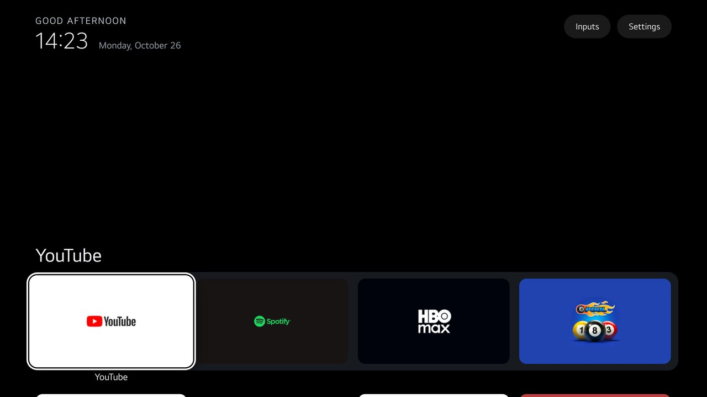

# CleanYourTV for LG webOS

A small, offline home screen for LG webOS TVs in Developer Mode, with no root. It has your favourite apps in a
dock, the rest in a grid or behind an App library button, Inputs and Settings, themes, add-ons, and 28
languages. A command-line tool on your computer installs it, checks every step on the TV, and removes it
again.

It is the webOS edition of [Gathin23/cleanyourtv](https://github.com/Gathin23/cleanyourtv), the Android TV
project, and works the way it does:

- the same theme keys, defaults and translations;
- the same model of Home: one ordered list whose first row is the dock;
- the same card rules for add-ons;
- the same rules: verify effects, record the state before any change, restore it, and keep everything
  optional off until asked for.

It is not endorsed by LG or by the main project.



> **Status:** runs on one TV so far: LG 50UQ7570PUJ, webOS 22, firmware 04.60.91 (`experimental-hardware` in
> [`profiles/`](profiles/)). Everything else is tested against simulated TVs. Read
> [docs/compatibility.md](docs/compatibility.md) before installing.

## What it does

- **Home:**
  - The dock is the first row, then the grid; `dock_only` keeps everything but the dock behind **App library**.
  - Predictable D-pad: hold OK on a tile for Open, Move or Launcher settings.
  - Magic Remote point and click, guarded against double launches.
  - Back never closes Home.
- **Top bar:** **Inputs** lists Live TV and your HDMI inputs by name. **Settings** opens LG's settings; hold OK
  on it for Launcher settings (columns, animations, the clock screensaver, wallpaper, Follow theme).
- **Header:** a greeting, the time and date, and, when asked, the Solar Hijri and lunisolar dates.
- **Screens:** wallpapers with rotation, moods and captions, a time-of-day sky, and an idle clock screensaver.
- **Languages:** the Android launcher's own translations, in 28 languages.
- **Offline and contained:**
  - no network at all;
  - a strict Content Security Policy;
  - the page can launch only apps it listed, through two fixed TV services.

## Try it on your computer

```sh
webos/cytv-webos preview                  # http://127.0.0.1:8642/preview/   (invented apps)
webos/cytv-webos preview --theme aurora   # with a theme
```

Arrow keys, Enter (hold it for menus), Escape. Options: `?apps=0`, `?fail=launch`, `?cards=1`, `?storage=off`.

## Install on a TV

**Step by step, with the LG developer account and the problems met on the way: [docs/setup.md](docs/setup.md).**
In short, you need:

- the TV in Developer Mode (LG's Developer Mode app, signed in with an LG developer account; Dev Mode Status
  and Key Server on);
- LG's CLI: `npm install -g @webos-tools/cli@3.2.6`.

```sh
ares-setup-device -a tv -i "host=<tv ip>" -i "port=9922" -i "username=prisoner"
ares-novacom --device tv --getkey                 # type the passphrase shown on the TV; then Key Server off
ares-setup-device -m tv -i "passphrase=<it>"      # only if the prompt above could not be answered

webos/cytv-webos setup   --device tv --host <tv ip>
webos/cytv-webos check   --device tv              # read-only report
webos/cytv-webos pair    --device tv              # accept the prompt on the TV
webos/cytv-webos sync    --device tv              # your apps, inputs and icons
webos/cytv-webos install --device tv --theme ~/my-theme
webos/cytv-webos confirm-ready --device tv        # after you have looked at it on the TV
```

Open **CYTV Home** from LG's app bar. To make it quick to reach, hold a number key on the remote to give it a
Quick Access slot. The Home button stays LG's: webOS gives an app no supported way to take it. The optional,
experimental `home` commands (an external watcher) are described in [docs/recovery.md](docs/recovery.md).

## Themes and add-ons

- **Themes:** [`themes/`](themes/) has the themes, and every key with its type and default. Your own theme
  belongs in a folder outside this repo: `install --theme ~/my-theme`. The tool remembers it for later
  installs.
- **Add-ons:** [`addons/`](addons/) holds small apps that can show a card on Home, approved by you on the
  computer: `addon install`, `addon approve`, `addon remove`.

## Safe to try, easy to undo

```sh
webos/cytv-webos status  --device tv       # what this tool installed, and any outcome still unknown
webos/cytv-webos restore --device tv       # remove it all; checks each app is gone
```

The tool installs Developer Mode apps and nothing else. It changes no system setting or system app; LG Home
stays as it is. It keeps a journal of every change and its result, read back from the TV:

- an install or removal whose result it could not see is `unknown` until the TV answers again, and nothing new
  happens until then;
- a failed removal is reported as `recovery_incomplete`, never as done;
- exit codes: 0 done and verified, 1 refused or failed, 2 unknown or incomplete.

Details: [docs/recovery.md](docs/recovery.md).

## Tests

```sh
python3 -m unittest discover -s webos/tests -t webos/tests     # install, restore, Home, SSAP, themes, add-ons, CLI
node --test 'webos/tests/js/*.test.js'                          # the launcher page under a fake DOM and TV
python3 webos/scripts/gen_docs.py --check                       # generated tables match the code
```

- **Python suite:** runs the real install, restore and watcher logic against a simulated TV with fault
  injection, and the `cytv-webos` command against fake `ares-*` programs.
- **JS suite:** runs the real launcher page and TV adapter, driven by remote keys.
- **Hardware checklist:** [docs/hardware-acceptance.md](docs/hardware-acceptance.md). A simulated TV is not a TV.

## Limitations

- **One TV.** One model has run it. Other webOS versions are eligible by profile, not proven.
- **Developer Mode expires.** When the session runs out, the TV removes Developer Mode apps. Renew it in LG's
  app; nothing here renews it for you.
- **The Home button stays LG's** (see above).
- **The app list is fixed at install.** It comes from `sync`; after installing new apps, run `sync` and
  `install` again.

## More

- **Repo files:** [CONTRIBUTING.md](CONTRIBUTING.md), [AGENTS.md](AGENTS.md), [SECURITY.md](SECURITY.md).
- **Design:** [docs/adr/](docs/adr/0001-architecture.md), [docs/specs/card.md](docs/specs/card.md).
- **Background:** [docs/source-audit.md](docs/source-audit.md), [THIRD_PARTY.md](THIRD_PARTY.md).
- **Licence:** MIT ([LICENSE](LICENSE)).
