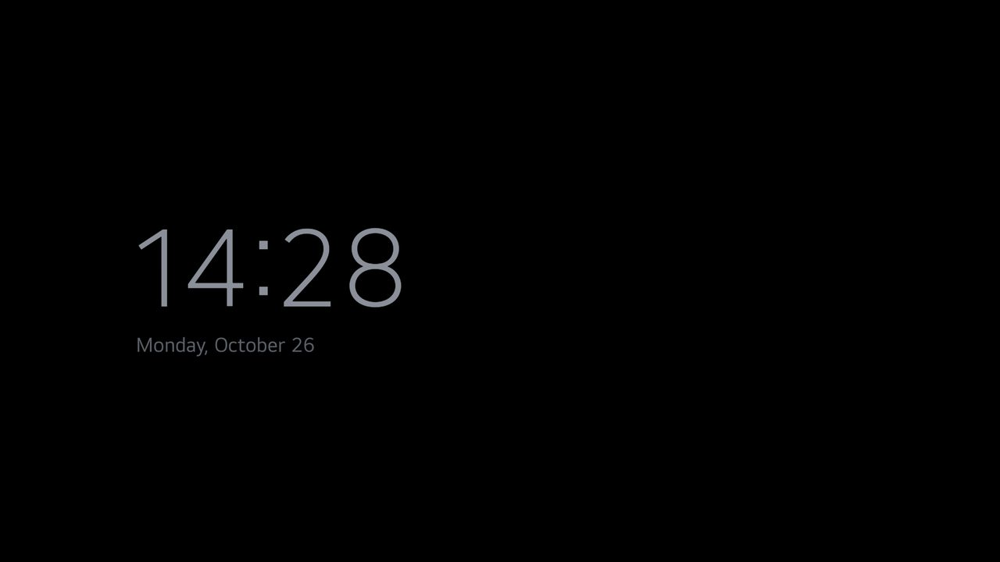

# Add-ons

An add-on is its own small webOS app that can show a **module card** on Home: its tile with a label, a caption
and a glow colour of its choice, placed after the dock apps and before the alphabetical grid. The card rules
are the Android launcher's spec 1; how a webOS launcher learns about a card is different, and is in
[`../docs/specs/card.md`](../docs/specs/card.md).

Nothing under `launcher/` changes for an add-on, and the launcher never mentions one by name.

| Add-on | What it does | Tested on | Screenshot |
|---|---|---|---|
| [`night-clock/`](night-clock/) | A calm, dim clock for the night that moves every minute and turns amber late; no permissions | LG 50UQ7570PUJ, webOS 22 |  |

```bash
webos/cytv-webos addon install --device tv night-clock     # install (journaled and read back like the launcher)
webos/cytv-webos addon approve --device tv night-clock     # show its card on Home: you decide on the computer
webos/cytv-webos sync --device tv && webos/cytv-webos install --device tv   # Home lists it, with its card
webos/cytv-webos addon remove --device tv io.github.samuelshernandez.cytvwebos.nightclock
```

Adding one: [`../docs/workflows/addon.md`](../docs/workflows/addon.md).
