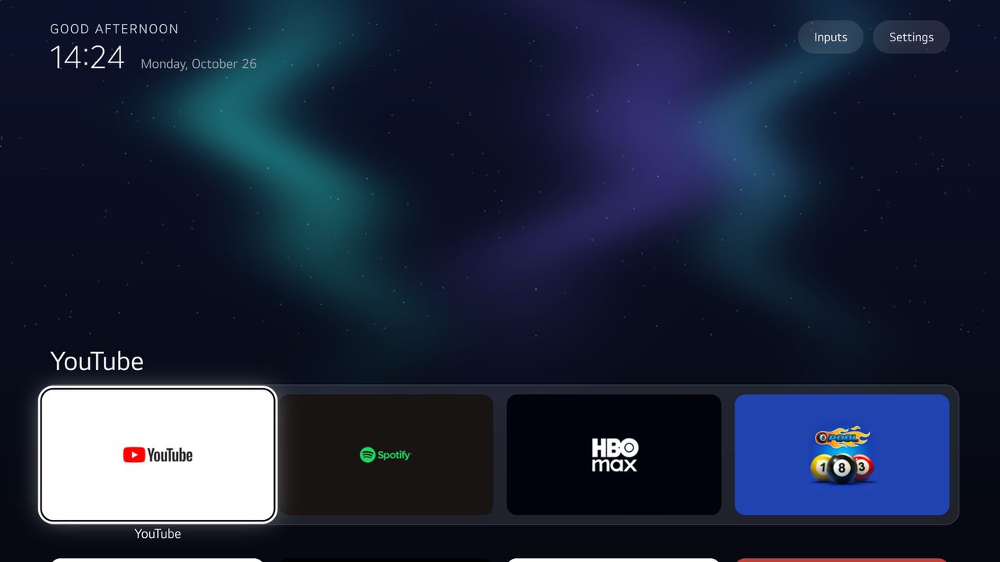
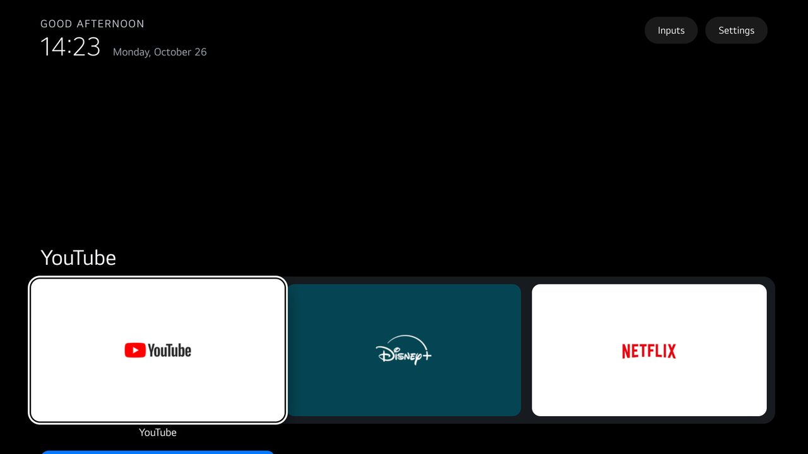
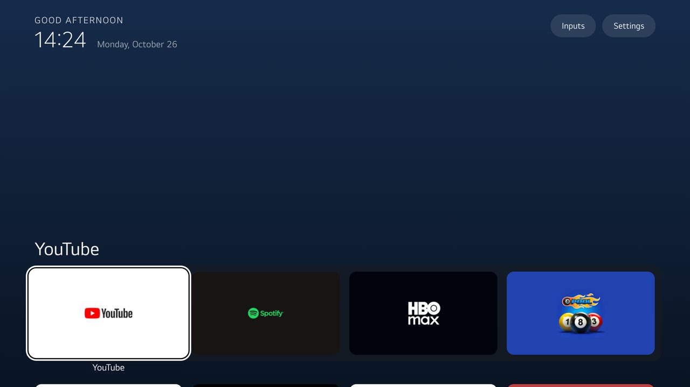
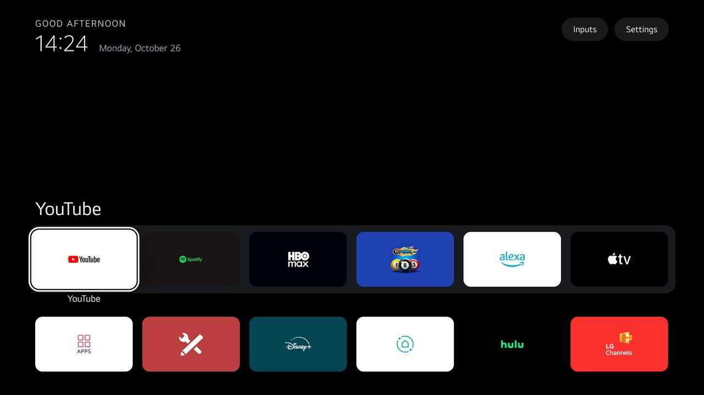

# Themes

A theme is a folder with a `config.json` and, optionally, a picture: a `wallpaper.jpg` (or `wallpaper.png`) or
a `wallpapers/` collection. Installing with a theme changes the launcher's dock, layout and look. The keys,
their names and their meaning are the Android launcher's (Gathin23/cleanyourtv `themes/README.md`), so a theme
reads the same on both. A key that only makes sense on Android is not listed here and is ignored on webOS.

```bash
webos/cytv-webos install --device tv --theme aurora               # a theme from this folder
webos/cytv-webos install --device tv --theme ~/my-theme           # your own folder, outside this repo
webos/cytv-webos preview --theme aurora                           # look at it on your computer first
```

A webOS app cannot receive files while it runs, so a theme is baked into the package at build time and
"pushing" a theme means installing again. That takes about ten seconds and is checked like any install.

As upstream:

- The theme's choices win until the owner changes columns, motion, the clock screensaver or the wallpaper in
  Launcher settings on the TV (hold OK on Settings).
- Installing a different theme clears those on-TV choices.
- **Follow theme** clears them too.
- The order the owner gave Home (Move) and their App library choices stay.

Personal themes, with your apps and your name, belong in a folder of your own, not in this repo.

<!-- generated:themes -->
| Theme | What it does | Screenshot |
|---|---|---|
| `aurora/` | Teal and violet curtains of light drawn in code (`make_wallpaper.py`), a frosted dock and a halo focus |  |
| `default/` | The built-in look written out as JSON, as a starting point for your own |  |
| `dock-only/` | Only the dock apps on Home, three big tiles; every other app waits in the App library (`dock_only`) |  |
| `night/` | A dark time-of-day sky, a rim-only focus, calm motion and the clock screensaver after ten minutes |  |
| `six-columns/` | Six smaller tiles per row and one grid row visible under the dock |  |
<!-- /generated:themes -->

Every theme folder here has a `screenshot.jpg` of Home on a real TV. `cytv-webos screenshot --device tv`
captures one from the TV's own web engine; `tests/test_themes.py` fails without it.

## Keys

Every key is optional. A missing key keeps the built-in value. An unknown or wrongly typed key is ignored on
the TV, which says so on screen, so a theme can never break Home. `cytv-webos build` is stricter and refuses
such a theme, so a typo is caught before it reaches a TV.

<!-- generated:keys -->
| Key | Type | Default | Meaning |
|---|---|---|---|
| `dock_apps` | list of app ids | `["netflix", "youtube.leanback.v4", "amazon", "com.disney.disneyplus-prod"]` | The first apps on Home, in order: the dock row. Apps the TV lacks are skipped. Once the owner moves apps on the TV, the saved order wins |
| `fill_dock` | bool | `true` | Fill the dock slots `dock_apps` leaves free with the first grid apps; `false` leaves them empty |
| `hidden_apps` | list of app ids | unset | Never shown as tiles (with `app_library`, the owner can add them back) |
| `app_labels` | list of `"id=Name"` | unset | A tile's name instead of the app's own, as `"id=Name"` |
| `live_tv_package` | app id | unset | The Live TV app for the Inputs menu's Live TV row; empty picks LG's own when the TV has it |
| `columns` | 1 to 8 | `4` | Tiles per row, the dock included (also in Launcher settings on the TV) |
| `rows_below_dock` | 0 to 3 | `0` | Grid rows left visible under the dock when Home opens |
| `dock_title` | bool | `true` | The focused dock app's name in large type above the dock |
| `dock_row` | bool | `true` | The dock as its own row with a band; `false` makes the dock apps the first tiles of one plain grid |
| `always_show_names` | bool | `false` | Names under every tile, dimmed until focused; `false` shows only the focused tile's name |
| `top_bar_apps` | list of app ids | unset | Apps shown as round buttons with their logo in the top bar; they leave the grid |
| `show_inputs_pill` | bool | `true` | The Inputs pill in the top bar |
| `icon_only_buttons` | bool | `false` | Settings as a round icon button; Inputs keeps its label |
| `dock_only` | bool | `false` | Home shows only `dock_apps` (and approved cards, and apps the owner adds back); every other app waits in the App library, whose pill is then always shown. Off by default |
| `app_library` | bool | `false` | An App library pill after the last Home row: every app, add one to Home or take it off. The choices stay on the TV when a theme changes |
| `module_cards` | bool | `true` | Show the cards of add-ons the owner approved (docs/specs/card.md); `false` turns the feature off |
| `app_keys` | list of `"code:target"` | unset | Remote buttons that open an app while Home is in front, as `"403:netflix"` (webOS key codes: 403 red, 404 green, 405 yellow, 406 blue); `inputs`, `settings`, `livetv` or `library` in place of the app opens that instead |
| `background_color` | `#RRGGBB` | `"#000000"` | Colour behind everything |
| `sky_intensity` | 0 to 100 | `0` | Time-of-day backdrop: a dark gradient that follows the clock; 0 hides it |
| `wallpaper` | bool | `true` | Show the theme's picture (`wallpaper.jpg` or its `wallpapers/` collection) (also in Launcher settings on the TV) |
| `wallpaper_rotation_minutes` | 0 to 1440 | `0` | Rotate the `wallpapers/` collection at this interval; 0 keeps one picture |
| `wallpaper_order` | `shuffle` or `sequential` | `"shuffle"` | How a collection advances: `shuffle` avoids repeating the current picture, `sequential` walks the folder in name order |
| `wallpaper_dim` | 0 to 90 | `0` | Black overlay over the wallpaper, in percent |
| `wallpaper_captions` | bool | `false` | The shown picture's name, from `wallpapers/captions.txt` (`001.jpg<TAB>Dusk over the peaks`) |
| `wallpaper_moods` | object | unset | A collection grouped by time of day: `{"morning": [...], "evening": [...], "night": [...]}`. Morning 07:00-12:00, evening until 18:30, night the rest (webOS gives the launcher no location for sun times) |
| `dock_opacity` | 30 to 100 | `100` | Opacity of the dock's band, in percent |
| `dock_band` | bool | `true` | Draw the dock band; `false` leaves the tiles floating on the background |
| `dock_glass` | bool | `false` | The dock band as light frosted glass |
| `glass_style` | `glass` or `rim` or `halo` | `"glass"` | The focus highlight: `glass` (translucent with a sheen and rim), `rim` (the rim alone) or `halo` (the rim with a soft outer glow) |
| `animations` | bool | `true` | Focus and tile motion (also in Launcher settings on the TV) |
| `reduced_motion` | bool | `false` | Calmer motion for slow TVs: every animation 90 ms or less, no overshoot |
| `focus_overshoot` | bool | `true` | The focused tile swings slightly past its size before settling |
| `show_greeting` | bool | `true` | The greeting above the clock |
| `greeting_name` | text (up to 40) | unset | A name after the greeting, e.g. `"Sam"` |
| `header_white` | bool | `false` | The date in full white instead of dimmed |
| `date_below_clock` | bool | `false` | The date on its own line under the clock |
| `shamsi_date` | bool | `false` | The Solar Hijri date above the Gregorian one |
| `lunar_date` | bool | `false` | The lunisolar date under the Gregorian one, e.g. `LUNAR 13/9 · YEAR OF THE HORSE` |
| `lunar_utc_offset` | -1 to 14 | `-1` | Hours east of UTC the lunar calendar is computed for: 7 Vietnamese, 8 Chinese; -1 picks 7 in Vietnamese and 8 otherwise |
| `locale` | language tag | unset | The launcher's language as a tag (`"vi"`, `"pt-BR"`) instead of the TV's |
| `home_idle_clock_minutes` | 0 to 1440 | `0` | Minutes Home may sit untouched before the clock screensaver; any key returns. 0 is off (also in Launcher settings on the TV) |
| `clock_glow` | bool | `true` | The clock screensaver's coloured glow; `false` for plain black (OLED) |
| `clock_wallpaper` | bool | `false` | The clock screensaver over the wallpaper instead of black |
| `clock_wallpaper_dim` | 0 to 90 | `50` | How dark that wallpaper is behind the clock, in percent |
<!-- /generated:keys -->

`app_keys` cannot map these keys, because the launcher or the TV needs them:

- OK, the arrows, Back, Escape and Backspace;
- Channel up and down;
- volume up, volume down and mute;
- 1056 and 1057.

## Not on webOS

These Android keys are not in the schema, because webOS gives a Developer Mode app no way to do what they do:

- **Android system screens:** source panels and vendor settings screens.
- **Accessibility key helpers:** for example `settings_key_keycodes`, `key_filter` and `home_long_press_home`.
- **Power-on and boot routing:** `boot_to_live_tv`, `power_on_home`.
- **Network and system readouts:** the VPN pill, `show_stats`.
- **A few looks not ported yet:** `cinematic_home`, `uniform_tiles`, `single_row`, `fade_rows`.

A look that needs a key this schema lacks is a launcher switch first, in its own change
(`docs/workflows/launcher-switch.md`).
